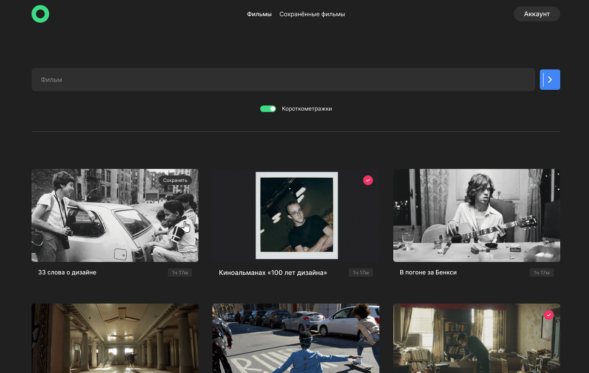

# Frontend-часть дипломного проекта Я.Практикум

## Сервис с поиском фильмов по запросу
Сайт позволяет регистрироваться, искать и сохранять понравившиеся фильмы, просматривать их youtube-трейлер.



 --- 

 ## Функциональность:

 ### Node.js

 * База данных фильмов со стороннего API
 * Все данные о пользователе, сохраненных фильмах и введенных данных в поле поиска сохраняются и хранятся на сервере, использовано собственное API
 * Добавление/удаление фильмов в избранное

 ### React, JS
 
* Реализован фильтр для подбора короткометражных фильмов
* Переход к показу youtube-трейлера фильма при нажатии на постер
* Возможность поиска фильмов как на русском, так и английском языках
* "Живая" валидация всех форм/полей ввода с использованием регулярных выражений
* Возможность редактирования своего профиля (имени и e-mail)
* Запоминание состояния авторизации пользователя
* Подгрузка дополнительных фильмов при нажатии на кнопку "Ещё"
* Использование собственных хуков
* Утилитарные функции, константы, функции обращения к серверу вынесены в отдельный файл
* Бургерное меню для мобильной и планшетной версии
* Защищённые роуты для невозможности посещения сайта неавторизованным пользователям
* Запоминание состояния полей ввода, фильтра короткометражек и найденных фильмов

 ### CSS
 
* Полноценый респонсив для всех популярных разрешений экрана
* Для создания сеток используется flex и grid
* При загрузке данных отображается прелоадер
* Приложение свёрстано по БЭМ, соблюдается семантичность

 --- 

## Используемые технологии:
Node.js 19  
React 18  
JS  
HTML 5  
CSS 3  

## Верстка сайта производилась по подготовленному макету
Для реализации данной части диплома был использован [макет dark-2](https://www.figma.com/file/6FMWkB94wE7KTkcCgUXtnC/light-1?type=design&node-id=1-7266&mode=design&t=zNus89utRChXTMkx-0)

 --- 

## Запуск проекта

Каталог фильмов берётся из стороннего публичного API. Авторизация, профиль и
сохранённые фильмы работают через слой `src/backend/`, который выбирает
провайдера автоматически:

* **mock-режим (по умолчанию)** — авторизация и сохранённые фильмы эмулируются
  в `localStorage`. Никакой настройки не требуется.
* **Supabase-режим** — включается, если в окружении заданы ключи Supabase.

### Быстрый старт (mock-режим)

```bash
npm install   # установка зависимостей
npm start     # запуск на http://localhost:3000
```

Регистрация и вход работают сразу: данные пользователей и сохранённые фильмы
хранятся в `localStorage` браузера. Mock-режим — это эмуляция, а не настоящая
авторизация:

* пароли хранятся в открытом виде;
* mock-токен формата `mock-token.<id>` тривиально подделывается через DevTools —
  любой посетитель может «войти» под чужим идентификатором, отредактировав
  `localStorage`.

Не используйте реальные пароли. Для боевого сценария включайте Supabase-режим
(см. ниже).

### Подключение Supabase (опционально)

1. Создайте бесплатный проект на [supabase.com](https://supabase.com/).
2. В **SQL Editor** выполните скрипт `supabase/schema.sql` — он создаёт таблицу
   сохранённых фильмов и политики доступа (RLS).
3. В **Authentication → Providers → Email** при желании отключите подтверждение
   почты (*Confirm email*), чтобы регистрация срабатывала сразу.
4. Скопируйте `.env.example` в `.env.local` и заполните оба значения ключами из
   **Project Settings → API**:

   ```
   VITE_SUPABASE_URL=https://<ваш-проект>.supabase.co
   VITE_SUPABASE_ANON_KEY=<anon public key>
   ```

5. Перезапустите `npm start`. В консоли появится строка `[backend] режим: Supabase`.

 --- 

## Сборка и деплой

* ```npm run build``` — production-сборка в каталог `build/`
* ```npm test``` — запуск тестов
* ```npm run preview``` — локальный просмотр собранного приложения
* ```npm run deploy``` — публикация на GitHub Pages (ветка `gh-pages`)

Приложение рассчитано на размещение в подпути
`https://<пользователь>.github.io/movies-explorer-frontend/` — `base` для
production-сборки и `basename` роутера заданы соответственно. Глубокие ссылки
(например, `/movies`) обслуживает `public/404.html` по приёму
[spa-github-pages](https://github.com/rafgraph/spa-github-pages): GitHub Pages
отдаёт его на неизвестные пути, а парный скрипт в `index.html` восстанавливает
исходный адрес. Чтобы деплой заработал, в настройках репозитория включите
GitHub Pages с источником — ветка `gh-pages`.

 --- 

## Замечание о хранении токена

Токен авторизации хранится в `localStorage` (в Supabase-режиме сессией заведует
клиент Supabase, тоже через `localStorage`). Это делает токен доступным любому
JS на странице и уязвимым к краже при XSS.

Полноценная защита — хранить токен в cookie с флагом `HttpOnly` — здесь
невозможна: такую cookie выставляет только сервер заголовком `Set-Cookie`, а у
проекта нет собственного бэкенда (mock работает целиком в браузере, а клиент
Supabase управляет сессией сам). Для боевого сценария это потребовало бы
тонкого серверного прокси перед Supabase — отдельная задача за рамками
фронтенда.

Что сделано для снижения риска: вывод React по умолчанию экранируется,
`dangerouslySetInnerHTML`/`eval` в коде нет, при выходе сессия провайдера
явно завершается (`Auth.logout()`).
